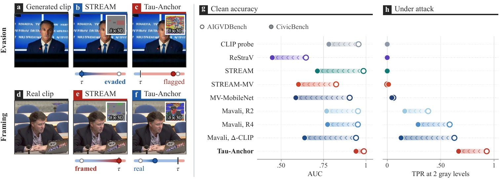
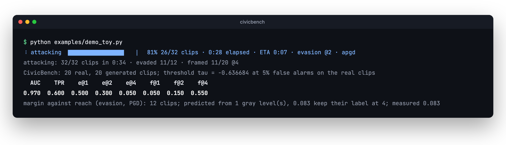

<p align="center">
  <picture>
    <source media="(prefers-color-scheme: dark)" srcset="docs/assets/banner-dark.jpg">
    <source media="(prefers-color-scheme: light)" srcset="docs/assets/banner-light.jpg">
    
  </picture>
</p>

<p align="center">
  <a href="#citation"></a>
  <a href="#data"></a>
  <a href="#install"></a>
  <a href="LICENSE"></a>
  
</p>

<p align="center">
  <a href="#quick-start"><b>Quick start</b></a> &nbsp;·&nbsp;
  <a href="#data"><b>Data</b></a> &nbsp;·&nbsp;
  <a href="docs/toolkit.md"><b>Toolkit guide</b></a> &nbsp;·&nbsp;
  <a href="#leaderboard"><b>Leaderboard</b></a> &nbsp;·&nbsp;
  <a href="tau_anchor/"><b>Tau-Anchor</b></a> &nbsp;·&nbsp;
  <a href="#citation"><b>Citation</b></a>
</p>

<br>

**CivicBench** tests detectors of AI-generated political video against the two attacks that matter in an election.
An attacker can change each pixel of a fake by a gray level or two, so that the detector passes it as real
(**evasion**). The same small change can make the detector flag real footage as generated (**framing**). Anyone who
wants to dismiss a real video can then point to the detector's verdict.

CivicBench measures both, on clips that can be shared, and one command runs it on your own detector.

<p align="center">
  
</p>

## Highlights

- **Two-sided by design.** Every detector is attacked in both directions, at the threshold where it is deployed.
  At one gray level, four published detectors lose every fake they flagged and flag nearly every attacked real clip.
- **Political and shareable.** 10,800 clips of invented politicians, parties and countries, from 8 open generators
  and 1,350 prompts across 9 kinds of civic scenes, next to 2,632 real clips under open licenses.
- **One command.** `civicbench evaluate` runs PGD, APGD and Square at any budget and prints the paper's table.
  Every attacked clip is checked after rounding to 8 bits, as a viewer would see it.
- **Predictive.** A cheap attack of one gray level predicts how many clips keep their label at four.

## Install

```bash
pip install civicbench              # core: numpy and torch
pip install "civicbench[data]"      # + loading from Hugging Face
pip install "civicbench[fancy]"     # + the rich progress display
```

Python 3.9 or newer.

## Quick start

```python
import civicbench

clips = civicbench.load()                         # official test inputs and labels
results = civicbench.evaluate(my_detector, clips) # AUC, TPR, evasion and framing at 1, 2 and 4 gray levels
```

Or from the command line, at any budgets:

```bash
civicbench evaluate --detector my_lab.detector:build --budgets 1,2,4,8,16 --out results.json
```

<p align="center">
  
</p>

<sub>Output of <code>examples/demo_toy.py</code>: a toy detector on synthetic clips, so the numbers carry no meaning.
It runs in under a minute with no downloads.</sub>

### Bring your own detector

A detector is any callable that maps frames to one score.

| | |
|---|---|
| **Input** | `torch.float32` tensor `[T, 3, H, W]`, RGB in [0, 1]. The official input is 11 frames of 512 x 512. |
| **Output** | One score. Higher means generated. A clip is flagged when its score reaches the threshold. |
| **Gradients** | PGD and APGD need a differentiable score. Square needs scores only. |

The [toolkit guide](docs/toolkit.md) covers single-clip attacks, custom budgets, the survival prediction and every
difference from the paper's code.

## Data

| | Repository | Access | License |
|---|---|---|---|
| **Real** | 2,632 clips of briefings, speeches, legislatures and protests | Open, no form | Each clip's own: public domain, CC BY or CC BY-SA |
| **Generated** | 10,800 clips from 8 open text-to-video generators, with prompts and settings | Gated, automatic approval | Research on detection, see the dataset card |

Each real clip lists its creator, license, source page, start time and the changes we made. The official test input is
11 frames of 512 x 512 per clip, stored as lossless PNG with checksums.

## Leaderboard

CivicBench at the threshold that flags 5% of real clips. Evasion is the TPR under attack, higher is better. Framing is
the false-alarm rate on attacked real clips, lower is better. Budgets are in gray levels on the 0 to 255 scale.

| Detector | AUC | TPR | Evasion 1 | Evasion 2 | Evasion 4 | Framing 1 | Framing 2 | Framing 4 |
|:---|:---:|:---:|:---:|:---:|:---:|:---:|:---:|:---:|
| **Tau-Anchor** (ours) | **.941** | **.779** | **.731** | **.668** | **.585** | .124 | .141 | .222 |
| Mavali et al., R4 | .774 | .394 | .339 | .289 | .239 | .217 | .304 | .623 |
| Mavali et al., R2 | .768 | .381 | .236 | .164 | .135 | .261 | .536 | .884 |
| Mavali et al., ΔCLIP | .638 | .182 | .135 | .130 | .099 | **.046** | **.046** | **.101** |
| MV-MobileNet | .587 | .086 | .045 | .043 | .035 | .348 | .493 | .565 |
| STREAM-MV | .602 | .111 | .018 | .013 | .011 | .768 | .783 | .812 |
| Shahjahan et al. | .709 | .233 | .023 | .000 | .000 | .913 | .971 | .986 |
| CLIP probe | .781 | .364 | .000 | .000 | .000 | 1.000 | 1.000 | 1.000 |
| STREAM | .714 | .309 | .000 | .000 | .000 | 1.000 | 1.000 | 1.000 |
| D3 | .475 | .028 | .000 | .000 | .000 | 1.000 | 1.000 | 1.000 |
| ReStraV | .448 | .009 | .000 | .000 | .000 | .986 | 1.000 | 1.000 |

Sorted by TPR under evasion at 2 gray levels, then at 1, then by AUC. The paper adds confidence intervals, two general benchmarks and
external political footage. To add a detector, open a pull request with the `results.json` that
`civicbench evaluate --out` writes.

## Tau-Anchor

Tau-Anchor is the detector from the paper. It fine-tunes an image encoder that was pre-trained on attacked images,
attacks real and generated clips during training, and adds a margin term for the fakes nearest its deployed threshold.
Its code and weights will be in [`tau_anchor/`](tau_anchor/).

## Repository layout

```
src/civicbench/     the pip package: load, attack, evaluate, predict_survival, CLI
tests/              unit tests and a golden test against the paper's attack code
examples/           demo_toy.py, a one-minute end-to-end run with no downloads
tau_anchor/         Tau-Anchor training and inference
docs/               toolkit guide and assets
```

## Responsible use

Framing perturbations of real clips are released only as perturbations, behind the gated repository, and are never
applied to the footage. The generated clips show invented people. If a clip resembles a real person, report it
through the contact on the dataset card and we will remove it.

## Citation

```bibtex
@inproceedings{civicbench2027,
  title     = {<paper title>},
  author    = {<authors>},
  booktitle = {<venue>},
  year      = {2027}
}
```

## License

The code is released under the [Apache License 2.0](LICENSE). The data follow the licenses in the table above and on
each dataset card. Generated clips also follow the terms of the generator that rendered them.

## Acknowledgements

We thank the creators of the openly licensed footage, credited clip by clip in the dataset, and the developers of
CogVideoX1.5, HunyuanVideo-1.5, Kandinsky 5, LTX-Video, Mochi, SANA-Video, Wan2.1 and Wan2.2.
